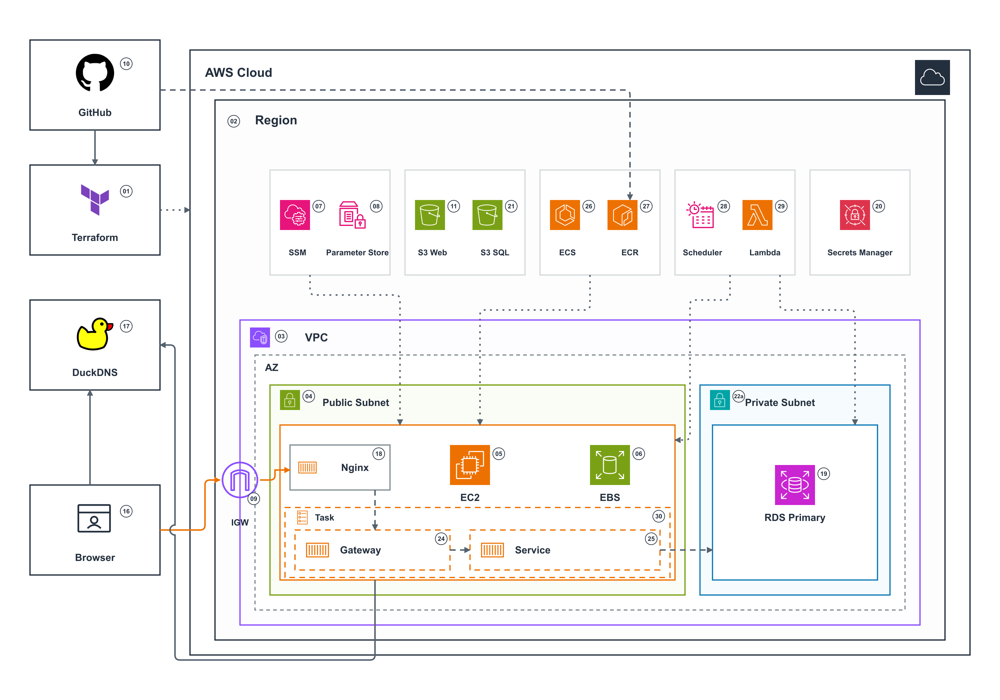

# OpenStudy AWS 아키텍처

[README로 돌아가기](../README.md)

2026-10-23에 확인한 AWS 배포 구조를 설명한다.
대상은 OpenStudy, AWS 서울 리전 `ap-northeast-2`, `openstudy.duckdns.org`이다.
기존 EC2와 RDS를 유지하고 Nginx CORS 설정과 정적 웹을 갱신했다.

## 최신 배치도

[크게 보기](images/openstudy-duckdns-deployment-numbered.svg) · [HTML](images/openstudy-duckdns-deployment-numbered.html) · [draw.io 편집 파일](images/openstudy-duckdns-deployment-numbered.drawio)

그림에는 작은 원형 번호와 짧은 영문 서비스 이름만 표시한다.
설명·포트·상태는 그림 밖에 둔다. 모든 서비스 아이콘에 이름을 붙인다.
실선은 웹 경로다. 긴 점선은 향후 앱 경로다. 짧은 점선은 관리 작업이다.
그림은 배치 구조를 표시한다. 선 모양은 현재 실행 여부를 뜻하지 않는다.

## 현재 운영 상태

| 항목 | 확인한 상태 |
| --- | --- |
| EC2·RDS | 2026-10-23 적용 후 EC2 `running`·RDS `available` 확인 |
| 웹 | Nginx 1.30.6의 HTTPS 정적 웹·CORS 검사 통과. 정적 파일 11개가 빌드와 일치 |
| DB | MySQL 8.4.11 Single-AZ Primary 한 대. 업무 테이블 58개와 Flyway 이력 1개 |
| 백업 | 자동 백업 보관 0일. 삭제 시 최종 스냅샷 생략. 삭제 보호 유지 |
| ECS·ECR | 클러스터와 ECR 저장소 두 개 준비. 앱 태스크·ECS 서비스 미배포 |
| Gateway·Service | 실제 앱 이미지 구현 전. 운영 중에도 live API는 연결 전 503 반환 |
| 운영 일정 | 서울 시간 평일 11:00 시작, 매일 18:00 중지, 18:30 중지 재시도 |

중지는 리소스 삭제를 뜻하지 않는다. 데이터와 저장 공간은 유지한다.
평일 11:00 자동 시작과 매일 18:00 중지 일정을 유지한다. 시작 후 준비 완료까지 시간이 추가로 필요하다.

## 서버와 컨테이너

EC2 `c7i-flex.large` 한 대를 사용한다. CPU 플랫폼은 AMD64, 메모리는 4GiB다.
EBS는 암호화한 gp3 30GiB다. 설계 예산은 월 50,000원이다.
계정에서 허용한 종류와 배치 영역에 맞춰 `ap-northeast-2b`를 사용한다.

Nginx는 별도 웹 컨테이너다. 현재 HTTPS와 Frontend 정적 파일을 제공한다.
향후 Gateway와 모듈형 Service는 같은 ECS Task의 컨테이너 두 개로 실행한다.
업무 모듈은 Service 내부에 둔다. 모듈마다 서버를 만들지 않는다.
실제 AMD64 이미지 두 개가 준비되면 ECS 서비스 하나가 태스크 하나를 배포한다.

앱 연결 후 요청은 사용자 → Nginx → Gateway → Service → RDS 순서로 처리한다.
Gateway와 Service는 아직 배포하지 않았다. 임시 앱으로 대체하지 않는다.
GitHub에서 ECR로 향하는 점선은 향후 이미지 빌드·게시 경로다.

## 네트워크와 DB

EC2는 퍼블릭 서브넷에 둔다. 외부에는 TCP 80·443만 허용한다.
HTTP는 HTTPS로 이동한다. DuckDNS는 기동 후 EC2 공인 IPv4를 갱신한다.
서버 관리는 Systems Manager를 사용한다.

RDS는 공인 IP가 없는 프라이빗 서브넷에 둔다.
Primary는 EC2와 같은 `ap-northeast-2b`에 배치한다. `multi_az=false`이며 대기 DB는 없다.
RDS 서브넷 그룹에는 서로 다른 두 AZ의 프라이빗 서브넷이 필요하다.
보조 AZ와 두 번째 서브넷은 그림에서 생략한다. 두 번째 DB를 뜻하지 않는다.

| 연결 | 포트와 제어 |
| --- | --- |
| 사용자 → Nginx | 공개 TCP 80·443 |
| Nginx → Gateway | 앱 연결 후 호스트 TCP 8081 |
| Gateway → Service | 같은 태스크의 내부 TCP 8080. Service 호스트 포트 미게시 |
| EC2·Service → RDS | TLS·TCP 3306. EC2 보안 그룹에서만 허용 |
| EC2 → SSM·S3·Parameter Store·Secrets Manager | 아웃바운드 HTTPS와 IAM 권한 |

RDS는 `db.t4g.micro`, 암호화한 gp3 20GiB를 사용한다.
DB 연결은 TLS를 사용한다. 시간대는 UTC다.
자동 백업과 삭제 시 최종 스냅샷은 사용자 요청으로 만들지 않는다.
실제 비밀번호와 토큰은 문서·그림·Git에 넣지 않는다.

## 운영 스케줄러

EventBridge Scheduler의 일정 세 개가 Lambda 함수 한 개를 호출한다.
두 서비스는 EC2 밖에서 실행한다. EC2가 꺼져 있어도 시작 요청을 보낼 수 있다.
Lambda는 IAM 권한으로 지정한 EC2와 RDS의 시작·중지 API를 호출한다.
실행 로그는 CloudWatch에 기록한다.

| 서울 시간 | 요청 |
| --- | --- |
| 평일 11:00 | EC2·RDS 시작 |
| 매일 18:00 | EC2·RDS 중지 |
| 매일 18:30 | EC2·RDS 중지 재시도 |

이미 시작하거나 중지한 리소스에는 같은 작업을 반복하지 않는다.
한쪽 요청이 실패해도 다른 리소스의 작업을 시도한다.
EC2가 시작되면 Nginx와 ECS 에이전트가 자동 실행된다.
실제 앱 이미지가 연결된 뒤에는 ECS가 Gateway·Service 태스크를 실행한다.

## 번호별 구성 요소

| 번호 | 이름 | 역할 |
| --- | --- | --- |
| 01 | Terraform | 인프라 구성과 배포 실행 관리 |
| 02 | Region | AWS 서울 리전 |
| 03 | VPC | 서비스 전용 네트워크 |
| 04 | Public Subnet | EC2 배치 |
| 05 | EC2 | Nginx·Docker·ECS 에이전트 실행 |
| 06 | EBS | 웹 파일·인증서·설정 보관 |
| 07 | SSM | 서버 관리와 설정·게시·DB 마이그레이션 실행 |
| 08 | Parameter Store | DuckDNS 토큰과 선택형 테스트 로그인 해시 보관 |
| 09 | IGW | 퍼블릭 서브넷의 인터넷 경로 |
| 10 | GitHub | 소스 저장소와 향후 이미지 빌드·게시 시작점 |
| 11 | S3 Web | Frontend 배포 파일 전달용 비공개 버킷 |
| 16 | Browser | 사용자 접속 |
| 17 | DuckDNS | 도메인과 공인 IPv4 연결 |
| 18 | Nginx | HTTPS·정적 웹 제공과 향후 API 중계 |
| 19 | RDS Primary | 유일한 DB 인스턴스 |
| 20 | Secrets Manager | RDS 관리자 비밀번호 관리 |
| 21 | S3 SQL | SQL·마이그레이션 파일 전달용 비공개 버킷 |
| 22a | Private Subnet | RDS Primary 배치 |
| 24 | Gateway | 향후 API 진입점 컨테이너 |
| 25 | Service | 향후 업무 모듈 컨테이너 |
| 26 | ECS | EC2의 앱 태스크 관리 |
| 27 | ECR | Gateway·Service 이미지 저장소 두 개 |
| 28 | Scheduler | 시작·중지 일정 실행 |
| 29 | Lambda | EC2·RDS 상태 확인과 시작·중지 요청 |
| 30 | Task | 향후 앱 컨테이너 두 개를 함께 실행하는 단위 |

## 그림 출처와 편집

AWS 서비스와 리소스에는 [AWS 공식 아키텍처 아이콘](https://aws.amazon.com/architecture/icons/)을 사용한다.
Terraform 표식은 [HashiCorp 공식 로고](https://www.hashicorp.com/en/brand/hcp-product-logos)를 따른다.
DuckDNS와 GitHub는 사용자가 제공한 로고다. 브라우저 표식은 프로젝트 벡터 도형이다.
HTML·SVG·draw.io에는 아이콘을 포함한다. 외부 이미지 다운로드 없이 볼 수 있다.
PNG는 문서 표시용이다. draw.io 파일은 영역·연결선·아이콘을 개별 편집할 수 있다.
