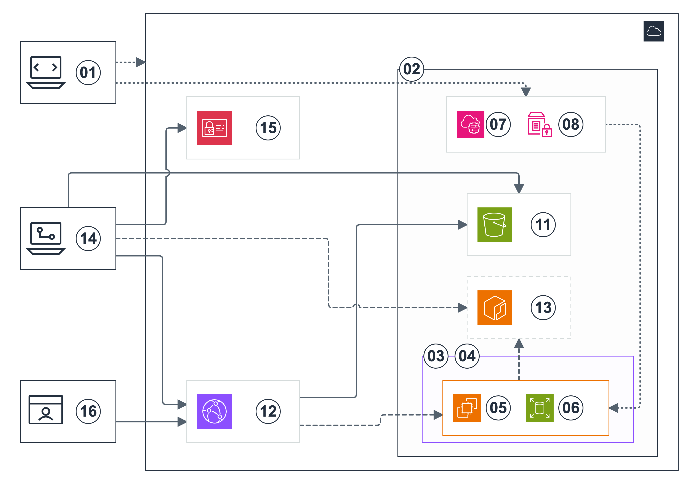

# OpenStudy AWS 아키텍처와 배포 흐름

현재 Backend 실행 경로는 Nginx → 단일 Backend → 비공개 RDS다. 최신 설정과 검증은 [AWS live 배포](aws-live-deployment.md)를 따른다.
[README로 돌아가기](../README.md)

최신 배치와 운영 상태는 [AWS 아키텍처 문서](architecture.md)를 따른다.
아래는 배포 절차를 함께 다루는 작업 문서다.
기존 AWS 공식 아이콘을 사용한다.
그림에는 원형 번호 마커와 짧은 영문 이름만 표시한다.
한글 설명·포트·상세 설정·범례는 그림 밖에 둔다.
인프라 배치와 배포 순서를 구분한다.

## 현재 상태

2026-10-22에 Nginx 1.30.6과 Frontend를 서울 리전에 배포했다.
`https://openstudy.duckdns.org`의 유효한 HTTPS 인증서와 정적 웹 응답을 확인했다.
RDS 스키마와 운영 스케줄 적용 후 최종 Terraform 계획은 `No changes`다.
2026-10-23에 기존 EC2·RDS를 유지하고 CORS 설정과 정적 웹을 갱신했다.
적용 후 HTTPS·정적 파일·CORS와 최종 계획의 `No changes`를 확인했다.
[최신 검증 기록](requirements.md#2026-10-23-커밋과-terraform-적용)을 따른다.
아래 그림은 월 5만 원 예산의 구성이다. 향후 Gateway·Service 경로도 함께 표시한다.

| 구분 | 코드·검증 상태 | 현재 AWS 상태 |
| --- | --- | --- |
| DuckDNS·EC2·Nginx 정적 웹 | 서버 `nginx -t`와 공개 HTTPS·CORS 검사 통과 | 2026-10-23 운영 시간에 정상 응답 |
| 테스트 계정 검증 | mock 모드에서 서버의 bcrypt htpasswd 파일로 검사한다 | 현재 프로필은 live 모드다 |
| RDS MySQL·Flyway | Single-AZ Primary·58개 업무 테이블과 Flyway 이력 1개 확인 | 2026-10-23 `available`. 이번 적용에서 DB 변경 없음 |
| S3·CloudFront 선택 경로 | 별도 Terraform 스택에 구현했다 | 삭제 상태 |
| ECS·ECR·운영 스케줄 | ECS 호스트 연결·ECR 두 개·운영 스케줄 세 개 확인 | 활성화. 앱 태스크는 0개 |
| Gateway·Service API | 향후 구현이다 | 미배포 |

## 1. AWS 배치도

[draw.io 편집 파일](images/openstudy-duckdns-deployment-numbered.drawio) · [SVG](images/openstudy-duckdns-deployment-numbered.svg) · [HTML 미리보기](images/openstudy-duckdns-deployment-numbered.html)

AWS Cloud 안에 서울 리전을 표시한다.
리전 안에서 VPC와 리전 관리 서비스를 구분한다.
EC2는 퍼블릭 서브넷에 둔다.
선택형 RDS는 같은 VPC의 프라이빗 서브넷을 사용한다.
S3·Systems Manager·Parameter Store·Secrets Manager는 VPC 바깥의 리전 서비스다.
인터넷 게이트웨이는 VPC 경계에 연결한다.

DB 서브넷 그룹은 서로 다른 두 가용 영역의 프라이빗 서브넷을 포함한다.
`multi_az = false`로 Primary 한 대를 EC2와 같은 AZ에 배치한다.
그림의 19번은 유일한 DB다. 대기 DB는 없다.
RDS 서브넷 그룹에는 두 AZ의 프라이빗 서브넷이 필요하다.
보조 AZ와 두 번째 서브넷은 그림에서 생략했다.
22a번은 Primary를 배치하는 프라이빗 서브넷이다. 현재 EC2와 Primary는 `ap-northeast-2b`를 사용한다.
Terraform의 두 서브넷 구성은 유지한다.

ECS는 EC2 한 대에서 Gateway·Service 두 컨테이너를 같은 태스크로 관리한다.
실제 이미지가 없는 현재는 ECS 클러스터와 ECR만 준비한다.
이미지를 둘 다 지정하면 Nginx → Gateway → Service → RDS 경로를 연결한다.
[월 5만 원 예산과 적용 절차](ecs-budget.md)를 따른다.

실선은 웹 경로다. 긴 점선은 향후 앱 경로다. 짧은 점선은 관리 작업이다.
선 모양은 현재 실행 여부를 뜻하지 않는다.

### 구성 요소 설명

| 번호 | 구성 요소 | 역할 |
| --- | --- | --- |
| 01 | Terraform 1.16.6 | AWS 네트워크·서버·선택형 DB와 배포 실행을 관리한다. |
| 02 | AWS 서울 리전 | 기본 리전은 `ap-northeast-2`다. |
| 03 | Amazon VPC | `10.42.0.0/16` 네트워크다. DNS 지원을 켠다. |
| 04 | 퍼블릭 서브넷 | `10.42.1.0/24`다. EC2를 두고 인터넷 게이트웨이로 기본 경로를 연결한다. |
| 05 | Amazon EC2 | 예산 프로필은 `c7i-flex.large`·AMD64·4GiB다. Docker·Nginx·ECS 에이전트를 실행한다. DB 적용 시 Flyway도 실행한다. |
| 06 | Amazon EBS | 예산 프로필은 암호화한 gp3 30GiB다. 웹 파일·인증서·서버 설정을 보관한다. |
| 07 | AWS Systems Manager | SSH 없이 서버 설정·웹 게시·DB 마이그레이션을 실행한다. |
| 08 | Parameter Store | DuckDNS 토큰과 테스트 로그인 이메일·비밀번호 해시를 SecureString으로 보관한다. |
| 09 | Internet Gateway | 퍼블릭 서브넷의 인터넷 접속을 연결한다. 프라이빗 DB 라우팅에는 연결하지 않는다. |
| 10 | GitHub | 소스 저장소와 배포 시작점이다. ECR로 향하는 점선은 향후 GitHub Actions 이미지 빌드·게시 경로다. |
| 11 | Frontend 배포용 S3 | 비공개 버킷의 `releases/*`에 웹 빌드 압축 파일을 보관한다. |
| 16 | 사용자 브라우저 | DuckDNS 주소로 HTTPS에 접속한다. mock 모드의 업무 데이터와 테스트 세션은 `sessionStorage`에 보관한다. |
| 17 | DuckDNS | EC2의 현재 공인 IPv4로 A 레코드를 갱신한다. 갱신기는 부팅 후와 약 15분 간격으로 확인한다. |
| 18 | Nginx 1.30.6 | 정적 파일·자동 HTTPS·서버 측 테스트 비밀번호 검증을 제공한다. |
| 19 | RDS Primary | MySQL 8.4.11의 기본 DB다. `db.t4g.micro`·암호화 gp3 20GiB·Single-AZ를 사용한다. |
| 20 | Secrets Manager | RDS 관리자 비밀번호를 자동 생성·관리한다. Terraform은 비밀번호 값을 조회하지 않는다. |
| 21 | SQL 배포용 S3 | DB를 활성화할 때 생성한다. `schema/*`에 버전별 SQL과 실행 스크립트를 보관한다. Frontend 배포 버킷과 별개다. |
| 22a | 프라이빗 DB 서브넷 | Primary를 배치하는 `10.42.20.0/24`다. 그림에서 생략한 두 번째 AZ의 `10.42.21.0/24`와 함께 RDS 서브넷 그룹을 구성한다. |
| 24 | Gateway | 향후 별도 앱 이미지다. 호스트 8081에서 API를 받아 Service로 전달한다. |
| 25 | Service | 업무 모듈을 포함한 단일 앱이다. 호스트 포트를 게시하지 않는다. |
| 26 | ECS | 한 EC2의 태스크 하나에 두 앱을 배치한다. |
| 27 | ECR | Gateway와 Service의 AMD64 이미지를 비공개로 보관한다. |
| 28 | Scheduler | 평일 11:00 시작, 매일 18:00 중지, 18:30 재시도를 요청한다. |
| 29 | Lambda | EC2와 RDS 상태를 확인하고 시작·중지한다. |
| 30 | ECS Task | Gateway·Service 컨테이너 두 개를 함께 실행하는 단위다. Nginx 컨테이너는 Task 밖에서 실행한다. |

EC2 IAM Role은 SSM 관리와 지정한 S3·Parameter Store 리소스 조회를 허용한다.
마이그레이션을 활성화하면 전용 비밀번호 파라미터와 SQL 배포 버킷 조회 권한을 추가한다.
실제 시크릿 값과 테스트 계정 비밀번호는 그림·Git·Terraform state에 넣지 않는다.
앱 비밀번호는 `/openstudy-prod/apps/` 아래 SecureString의 ARN만 ECS에 전달한다.
앱은 RDS 관리자 계정을 사용하지 않는다.

## 2. 네트워크와 데이터 경계

| 연결 | 포트·제어 | 동작 |
| --- | --- | --- |
| 사용자 → DuckDNS | DNS 조회 | EC2 공인 IPv4를 확인한다. |
| 사용자 → EC2 Nginx | TCP 80·443 | HTTP를 HTTPS로 이동한다. 정적 파일과 `/api/test-login`을 제공한다. |
| EC2 → DuckDNS | HTTPS 443 | IMDSv2로 확인한 공인 IP를 갱신한다. |
| EC2 ↔ SSM | 아웃바운드 HTTPS 443 | SSM 제어 화살표는 논리 방향이다. SSH 인바운드는 열지 않는다. |
| EC2 → Parameter Store | HTTPS 443 | 토큰과 테스트 로그인 해시를 읽는다. |
| EC2 → 비공개 S3 | HTTPS 443 | IAM Role로 배포 파일을 내려받고 SHA-256을 검사한다. |
| EC2 → Parameter Store | HTTPS 443·DB 선택형 | 마이그레이션 계정의 비밀번호를 읽는다. |
| Nginx → Gateway | 컨테이너 → 호스트 TCP 8081 | 실제 앱 이미지 두 개를 지정하면 API 프록시를 켠다. |
| Gateway → Service | Docker bridge TCP 8080 | 같은 태스크의 내부 이름 `service`로 접속한다. |
| EC2 Flyway → RDS | TLS·TCP 3306·DB 선택형 | DB 보안 그룹은 EC2 보안 그룹만 허용한다. 인증서와 DB 호스트 이름을 검사한다. |

mock 모드의 업무 데이터는 브라우저에 저장한다.
테스트 로그인 비밀번호만 서버에서 검사한다.
이 설정은 실제 Backend 세션과 업무 DB 연결을 구현한 상태를 뜻하지 않는다.
Nginx에서 앱 이미지가 없는 일반 `/api/*` 요청은 JSON 503을 반환한다.
브라우저 mock 모드에서는 MSW가 구현한 업무 요청을 처리한다.

현재 예산 프로필은 자동 백업 보관 0일과 `skip_final_snapshot=true`를 사용한다.
사용자 요청으로 자동 백업과 삭제 시 최종 스냅샷을 만들지 않는다. 삭제 보호는 유지한다.
DB 시각은 UTC다. 영업일 계산은 애플리케이션에서 서울 시간으로 처리한다.

## 3. 생성·게시·삭제 순서

### DuckDNS·EC2 웹

1. Terraform 1.16.6, Node.js 24, npm, Python, AWS CLI와 Frontend 소스를 준비한다.
2. DuckDNS 토큰을 Parameter Store에 등록한다.
3. mock 로그인을 사용하면 Git 제외 파일의 계정으로 서버용 테스트 로그인 해시를 등록한다.
4. `enable_frontend = true`와 공개 TCP 80·443 설정으로 새 계획을 확인하고 적용한다.
5. Terraform이 서버 설정 성공을 기다린 뒤 검사·빌드·S3 게시·SSM 배포·HTTPS 확인을 실행한다.

[DuckDNS 웹 배포 절차](duckdns-frontend.md)를 따른다.
현재 기본 API 모드는 `live`다. 테스트용 배포는 `frontend_api_mode = "mock"`을 명시한다.

### 선택형 RDS와 테이블

1. `enable_database = true`로 설정한다. 기본값은 `false`다.
2. 새 계획에서 두 프라이빗 서브넷·RDS의 `multi_az = false`·SQL 버킷·SSM 실행 연결을 확인한다.
3. 적용하면 AWS가 Primary 한 대를 생성한다. DB 계정을 별도로 준비한다.
4. 마이그레이션을 활성화하면 Flyway가 통합 V1과 이력 테이블을 적용한다.
5. 이후 변경은 V2 이상의 새 SQL 파일로 추가한다. 이미 적용한 V1은 수정하지 않는다.

[DB 배포 절차](database.md)를 따른다.
기본값 `apply_database_migrations = false`는 DB 계정 준비 전 마이그레이션을 실행하지 않는다.
Backend API의 업무 데이터 저장과 애플리케이션용 DB 계정은 후속 구현이다.

### 사용 후 삭제

RDS를 만들었다면 삭제 보호를 먼저 해제하고 적용한다.
그다음 삭제 계획을 확인하고 Terraform 리소스를 삭제한다.
최종 스냅샷·수동 백업·별도 등록한 프로젝트 토큰은 별도로 확인한다.
[AWS 전체 정리](teardown.md)를 따른다.

## 4. S3·CloudFront 선택 경로

[draw.io](images/openstudy-terraform-deployment-numbered.drawio) · [SVG](images/openstudy-terraform-deployment-numbered.svg) · [HTML](images/openstudy-terraform-deployment-numbered.html)

이 그림은 기본 DuckDNS 경로와 별개인 선택형 구성이다. 현재 배포하지 않았다.
`terraform/frontend`는 S3·CloudFront·OAC·SPA 함수·GitHub OIDC 역할을 별도 state로 관리한다.
이 스택은 기본 적용에서 로컬 Frontend 빌드·게시도 실행한다.
GitHub Actions를 통한 게시를 선택할 수도 있다.
ECR·Backend 이미지 배포와 API 원본 연결은 이 그림의 후속 경로다.

왼쪽 위부터 Terraform·GitHub Actions·사용자 브라우저를 표시한다.
AWS 안쪽 왼쪽에는 GitHub OIDC 배포 역할과 CloudFront를 표시한다.
리전 안쪽에는 SSM·Parameter Store, S3, ECR과 EC2·EBS를 표시한다.
RDS·네트워크의 최신 배치는 1절의 AWS 배치도를 기준으로 한다.
[Frontend 선택형 배포](frontend-deployment.md)와 [GitOps 설계](gitops.md)를 따른다.

## 근거와 편집

- [AWS 네트워크·EC2 코드](../terraform/aws/main.tf)
- [Frontend 배포 코드](../terraform/aws/frontend.tf)
- [RDS·마이그레이션 코드](../terraform/aws/database.tf)
- [ECS·ECR 코드](../terraform/aws/ecs.tf)
- [운영 스케줄 코드](../terraform/aws/schedule.tf)
- [예산 계산](../scripts/estimate-budget.py)
- [Nginx 설정](../terraform/aws/templates/nginx.conf.tftpl)
- [AWS 공식 아키텍처 아이콘](https://aws.amazon.com/architecture/icons/)

`python3 scripts/render-architecture.py`로 기본 배치도의 HTML과 draw.io를 다시 만든다.
SVG와 PNG도 함께 갱신한다. 아이콘·영역·연결선은 draw.io에서 개별 편집할 수 있다.
번호는 20px 크기의 작은 원형 마커로 표시한다.
모든 서비스에 아이콘과 짧은 영문 이름을 표시한다.
GitHub·DuckDNS는 사용자 제공 로고를 사용한다. Gateway·Service·Nginx는 컨테이너 아이콘으로 표시한다. 그림에는 짧은 영문 이름만 넣는다. 설명과 포트 표기는 그림 밖에 둔다.
공식 아이콘의 출처는 [아이콘 안내](images/icons/README.md)에 정리한다.
기존 AWS 색상을 유지한다. 상세 설명은 문서에서 관리한다.
