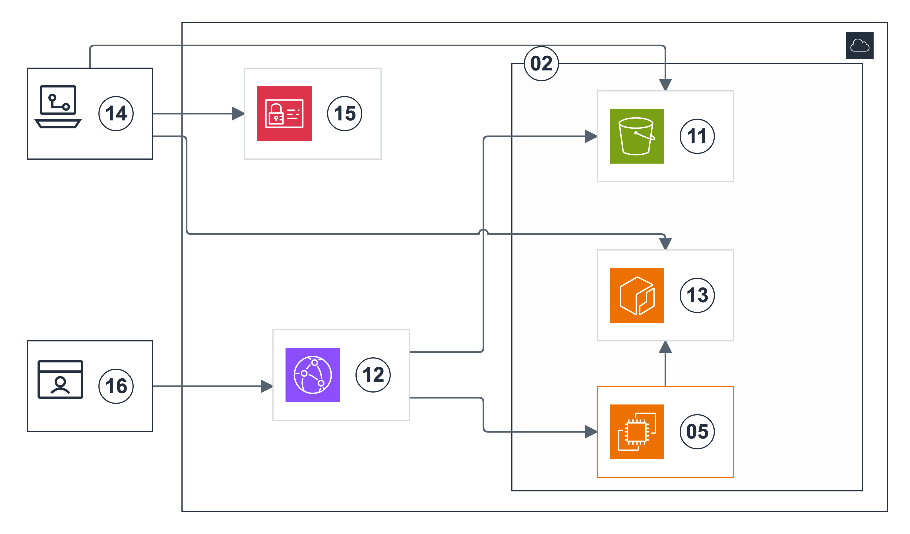

# 정적 호스팅·OCI 이미지 배포 설계

[README로 돌아가기](../README.md)

Frontend S3·CloudFront·OIDC 역할과 GitHub Actions 코드를 추가했다.
[Frontend 배포 순서](frontend-deployment.md)에서 실제 생성과 배포를 실행한다.
Backend OCI·ECR·GitOps 연동은 구현 예정이다.

## 1. 저장소와 배포 대상

| 저장소 | 확인한 빌드 구성 | 배포 목표 |
| --- | --- | --- |
| [OpenStudy-Frontend](https://github.com/OpenStudyService/OpenStudy-Frontend) | Node.js 24·React·Vite, `npm run build` | `dist/` → 비공개 Amazon S3 → Amazon CloudFront |
| [OpenStudy-Backend](https://github.com/OpenStudyService/OpenStudy-Backend) | Java 21·Spring Boot·Gradle, Docker 기반 테스트 | ARM64 OCI 이미지 → Amazon ECR → Amazon EC2 |
| OpenStudy-Infra | Terraform·SSM | 인프라·배포 설정·전체 삭제 관리 |

Frontend의 운영 빌드는 실제 `/api`를 호출한다.
시연용 `build:demo`는 운영 배포에 사용하지 않는다.

## 2. 아키텍처와 네트워크

[SVG 원본](images/openstudy-aws-delivery-numbered.svg)을 함께 제공한다. 그림에는 번호만 표시한다.

| 번호 | AWS 서비스·구성 요소와 설명 |
| --- | --- |
| 02 | AWS Region — 서울 리전(`ap-northeast-2`)이다. |
| 05 | Amazon EC2 — Backend OCI 컨테이너를 실행한다. |
| 11 | Amazon S3 — Frontend의 `dist/`를 비공개 버킷에 저장한다. |
| 12 | Amazon CloudFront — 정적 파일과 API의 HTTPS 접속을 제공한다. |
| 13 | Amazon ECR — Backend OCI 이미지를 저장한다. |
| 14 | GitHub Actions — 정적 파일 게시와 OCI 이미지 빌드를 실행한다. |
| 15 | AWS IAM / AWS STS — 배포 역할과 OIDC 인증으로 단기 자격 증명을 제공한다. |
| 16 | 사용자 브라우저 — CloudFront 주소로 웹 화면과 API를 호출한다. |

| 관련 번호 | 연결 | 설정 기준 |
| --- | --- | --- |
| 16→12 | 브라우저 → CloudFront | TCP 443, 공통 HTTPS 주소 |
| 12→11 | CloudFront → S3 | HTTPS, OAC 서명 요청으로 읽기 |
| 12→05 | CloudFront → EC2 | TCP 443, `/api/*`, API 캐시 비활성화 |
| 14→15 | Actions → IAM·STS | TCP 443, 저장소·브랜치를 제한한 OIDC 신뢰 |
| 14→11 | Actions → S3 | TCP 443, `dist/` 게시와 CloudFront 캐시 갱신 |
| 14→13 | Actions → ECR | TCP 443, ARM64 OCI 이미지 push |
| 05→13 | EC2 → ECR | TCP 443, IAM Role 인증 후 digest 기준 pull |

아이콘은 [AWS 공식 아키텍처 아이콘](https://aws.amazon.com/architecture/icons/)을 사용한다.

## 3. 구현 순서

1. `terraform/frontend`로 S3·CloudFront·OAC와 Frontend 배포 역할을 생성한다. Backend의 Private ECR·배포 역할은 후속으로 추가한다.
2. GitHub OIDC 신뢰를 저장소와 배포 브랜치로 제한한다. Frontend 게시 역할과 Backend ECR push 역할을 분리한다.
3. Frontend 검사 후 `npm run build`를 실행한다. `dist/`를 S3에 게시하고 CloudFront 캐시를 갱신한다.
4. Backend 테스트 후 `linux/arm64` OCI 이미지를 빌드한다. 커밋 SHA 태그로 ECR에 push하고 digest를 기록한다.
5. 배포 설정에 ECR digest를 반영한다. EC2는 IAM Role로 인증한 뒤 이미지를 pull한다.
6. 웹 화면·API·헬스체크와 이전 버전 복구를 확인한다.

OCI는 컨테이너 이미지 형식이다.
OIDC는 GitHub Actions가 AWS 단기 자격 증명을 받는 인증 방식이다.

## 4. 정적 웹과 API 경로

| 경로 | 원본 | 설정 |
| --- | --- | --- |
| 기본 정적 경로 | Amazon S3 | 공개 접근 차단, CloudFront OAC 읽기 허용 |
| `/api/*` | EC2 HTTPS 원본 | API 캐시 비활성화, 쿠키·인증 헤더·쿼리 전달 |

Frontend 주소는 CloudFront 기본 HTTPS 주소를 사용한다.
Backend 원본 Host와 인증서는 `openstudy.duckdns.org`에 맞춘다.
원본 프록시 뒤의 Backend·MySQL 포트는 외부에 공개하지 않는다.
정적 SPA 경로만 `index.html`로 연결한다. API 오류에는 적용하지 않는다.
세션·CSRF·SSE 전달은 Backend 연결 후 통합 검증한다.

## 5. 이미지와 정리

- ECR 이미지 태그는 커밋 SHA를 사용한다. 배포는 digest로 고정한다.
- EC2의 ECR 권한은 이미지 읽기로 제한한다. GitHub의 이미지 게시 권한과 분리한다.
- 운영 중 이전 정상 이미지와 Frontend 릴리스 버전을 기록한다.
- 사용 후 [AWS 전체 정리](teardown.md)에 CloudFront 배포·OAC, S3 객체·이전 버전, ECR 이미지·리포지토리와 프로젝트 배포 역할을 포함한다.

## 근거

빌드 구성은 [Frontend package.json](https://github.com/OpenStudyService/OpenStudy-Frontend/blob/main/package.json)과 [Backend build.gradle](https://github.com/OpenStudyService/OpenStudy-Backend/blob/main/build.gradle)을 기준으로 한다.
서비스 구성은 [CloudFront OAC](https://docs.aws.amazon.com/AmazonCloudFront/latest/DeveloperGuide/private-content-restricting-access-to-s3.html), [ECR 이미지 형식](https://docs.aws.amazon.com/AmazonECR/latest/userguide/image-manifest-formats.html), [GitHub OIDC](https://docs.github.com/en/actions/how-tos/secure-your-work/security-harden-deployments/oidc-in-aws)를 따른다.
