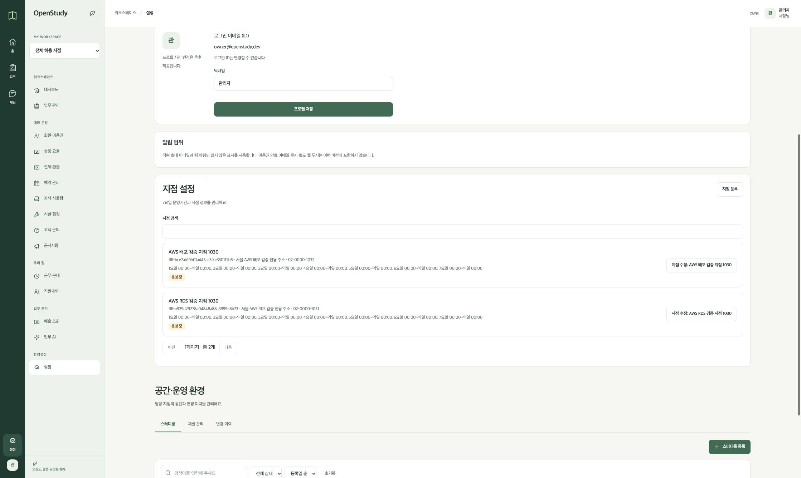
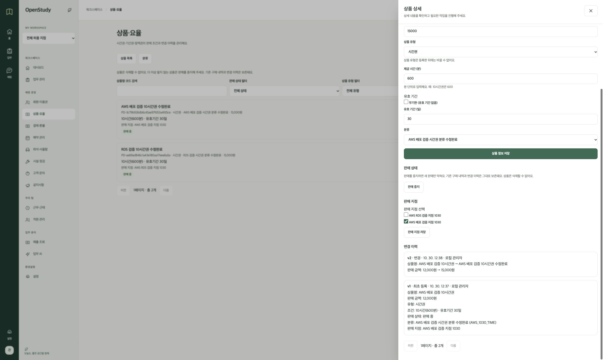
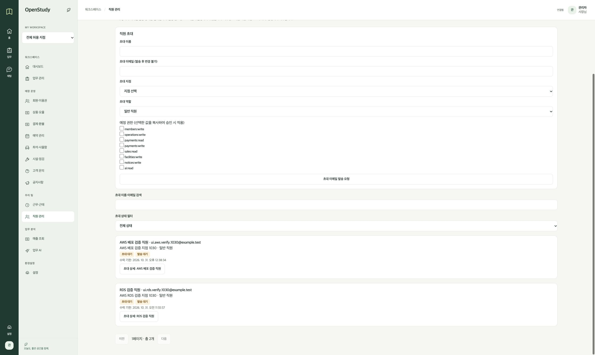

# 2026-10-30 AWS 전체 배포와 실제 연결 검증

## 배경과 결정

로컬 Frontend·Backend와 SSM DB 터널로 진행한 검증을 AWS 실행으로 옮겼다.
사용자가 기존 서울 리전 EC2·RDS와 `https://openstudy.duckdns.org` 배포를 승인했다.
Terraform으로 적용했다. Backend 운영 계약의 권장안에 따라 별도 Gateway 대신 단일 Backend를 사용했다.
Nginx가 HTTPS와 정적 파일·API 전달을 담당한다.

## 적용 내용

- Frontend: `b29aa7bf6baf8dce5841f6fc28ab4dd4228d91e5`, live 빌드.
- Backend: `d5b68f8346f4ae68edde7e8d1b897bd3894bb286`, AMD64 운영 이미지.
- ECR digest: `sha256:f8f8562668ee4de4d74091bf83b2884b40cfca528b08a6a42993c1165e0000d3`.
- ECS: `prod`, 단일 Backend, 2,048MiB, 컨테이너 8080 → 호스트 8081.
- Nginx → Backend의 실제 연결 소켓에서 상대 주소 `172.17.0.1`을 측정했다. 이 주소만 신뢰 프록시로 설정했다.
- 앱 계정은 `openstudy_app`이다. 비밀번호는 기존 SSM SecureString ARN으로 주입한다.
- DuckDNS 토큰을 기존 프로젝트 문서에서 확인해 원래 SSM SecureString 경로에 저장했다. 값은 Git·Terraform 변수·로그에 넣지 않았다.
- Infra SQL을 Backend의 V1·V2 원본과 맞췄다. RDS는 이미 두 버전이 적용된 상태다. 체크섬 변경·repair·clean·baseline을 하지 않았다.
- 워크트리의 local backend는 기존의 동일한 Terraform state 경로를 사용했다.

Terraform 적용 결과는 14개 생성·3개 변경·6개 삭제다.
EC2와 RDS는 `no-op`으로 유지했다. 빈 Gateway ECR 저장소·정책과 교체한 SSM 연결·SQL 객체를 정리했다.
실행 중인 ECS 태스크와 Backend 컨테이너는 `HEALTHY`다. 최종 Terraform 계획은 `No changes`다.

## 검증 결과

- Backend 테스트: 293건 통과.
- Frontend 테스트: 209건 통과. 운영 빌드 성공.
- Infra 전체 검사: Terraform AWS 37건·Cloudflare 5건·Frontend 8건 통과. Node 검사 통과. Python 45건 통과·5건 환경 조건으로 제외.
- ECS 환경 거절 조건을 보완한 최종 검사: 12건 통과. 필수 운영 환경 누락을 별도로 거절한다.
- 로컬 Vite·Backend와 SSM DB 터널을 종료한 뒤 AWS HTTPS 브라우저로 검증했다.
- 로그인, 지점 등록, 카테고리 등록·수정, 상품 등록·수정, 직원 조회·초대 생성을 확인했다.
- 상품 가격 12,000원 → 15,000원과 생성·수정 이력 2건을 확인했다.
- 새 지점·카테고리·상품·초대 ID는 각각 2다. 초대는 새로고침 후에도 `PENDING`이다.
- ECS Backend 컨테이너의 앱 계정으로 RDS를 읽어 화면과 저장값이 같은지 대조했다.
- DB TLS와 인증서 호스트 검증을 사용한다. TLS 세션 암호는 `TLS_AES_256_GCM_SHA384`다.
- HTTP → HTTPS 308, Secure·HttpOnly·SameSite=Lax·Path=/ 쿠키, 로그인 세션 ID 갱신을 확인했다.
- CSRF 누락·위조 요청은 403이다. 정상 토큰 로그인은 200이다.
- 실제 SSE heartbeat와 로그아웃 쿠키 만료를 확인했다. 로그아웃 후 `/api/me`는 401이다.

[비밀값 없는 검증 결과](../verification/aws-live-2026-10-30.json)

## 남은 범위

이번 검증으로 Infra #2의 모든 인수 조건을 완료한 것은 아니다.
권한 회수·계정 제한·세션 만료·동시 수정·닉네임·배포 실패 복구의 전체 시나리오는 별도 검증 대상이다.
초대 생성까지만 확인했다. 메일 작업은 `PENDING`, 시도 0건이다. 실제 SMTP 발송·수락·승인은 수행하지 않았다.
대시보드·업무 관리 등 미구현 Backend API는 구현 완료로 보고하지 않는다.
기존 평일 11시 시작·매일 18시 중지 스케줄과 삭제 보호를 유지한다.
PR 병합은 사용자가 진행한다.
