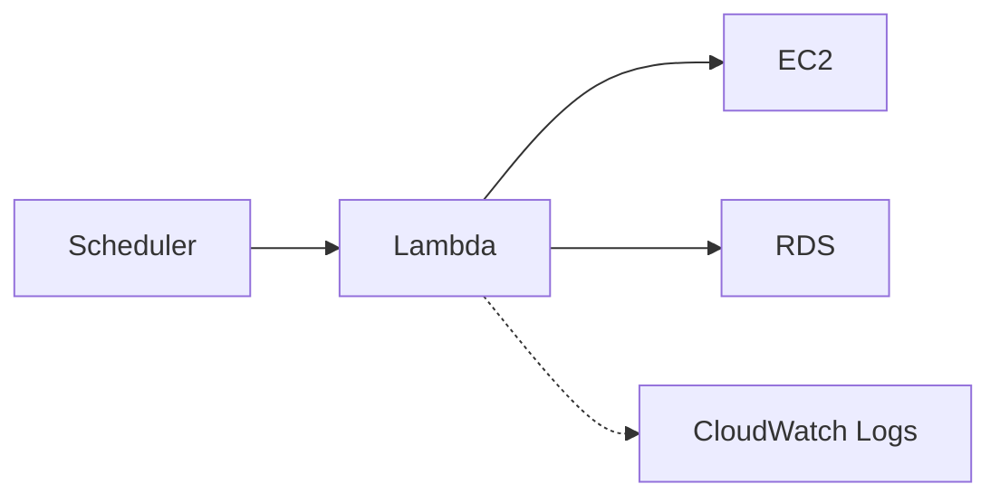

# ECS 월 5만 원 구성

대상은 OpenStudy-Infra/main, AWS 서울 리전, `openstudy.duckdns.org`이다.
Cloudflare나 다른 저장소로 배포 대상을 바꾸지 않는다.
2026-10-21 사용자 요청의 최종 예산은 월 50,000원이다.

## 구성

| 항목 | 구성 |
| --- | --- |
| 서버 | EC2 `c7i-flex.large` 한 대, AMD64, 메모리 4GiB |
| 컨테이너 관리 | ECS의 EC2 실행 방식. 클러스터 한 개 |
| 앱 | Gateway와 모듈형 Service. 같은 ECS 태스크의 컨테이너 두 개 |
| 웹 진입점 | Nginx·DuckDNS·HTTPS. Nginx는 호스트의 별도 웹 컨테이너 |
| DB | RDS MySQL 8.4.11 `db.t4g.micro` Single-AZ Primary 한 대 |
| DB 백업 | 사용자 요청으로 자동 백업·삭제 시 최종 스냅샷 비활성화. 삭제 보호 유지 |
| 저장 공간 | EBS gp3 30GiB, RDS gp3 20GiB |
| 이미지·로그 | 비공개 ECR 두 개. CloudWatch Logs 7일 보관 |
| 운영 시간 | 평일 11:00 시작, 매일 18:00 중지, 서울 시간 |

애플리케이션 컨테이너는 두 개다. 기존 Nginx와 ECS 에이전트는 별도 기반 프로세스다.
업무 모듈은 Service 내부에 둔다. ECS 서비스 하나가 두 컨테이너를 함께 배포한다.
ALB·NAT Gateway·Fargate·RDS Standby는 생성하지 않는다.
현재 계정은 t4g.medium 생성을 허용하지 않아 같은 4GiB의 c7i-flex.large를 사용한다.
이 계정의 서울 리전에서는 b·d AZ에서 제공된다. 프로필은 `ap-northeast-2b`를 지정한다.
RDS 서브넷 그룹은 두 AZ를 사용한다. DB는 EC2와 같은 AZ 한 곳에만 둔다.
서버 장애 시 앱 전체가 중지된다. 배포할 때도 기존 태스크를 먼저 중지한다.

## 월 비용

AWS Price List API의 서울 리전 온디맨드 단가를 2026-10-22에 확인했다.
무료 크레딧과 무료 사용량은 차감하지 않는다.
평일 최대 23일 × 7시간 = 161시간으로 계산한다.
저장 공간은 31일 계속 보관하는 조건이다.
환율 1달러당 1,500원은 계산 가정이다. 부가세 10%를 반영한다.

| 항목 | 단가와 사용량 | 월 USD, 세전 |
| --- | --- | ---: |
| EC2 | 0.09576/시간 × 161시간 | 15.42 |
| 공인 IPv4 | 0.005/시간 × 161시간 | 0.81 |
| RDS Primary | 0.025/시간 × 161시간 | 4.03 |
| EBS | 0.0912/GiB·월 × 30GiB, 31일 | 2.79 |
| RDS 저장 공간 | 0.131/GiB·월 × 20GiB, 31일 | 2.67 |
| DB 관리자 시크릿 | 한 개 | 0.41 |
| ECR | 총 2GB | 0.20 |
| 로그 | 월 1GB 수집·보관 | 0.79 |
| 인터넷 전송 | 1GB, 무료분 차감 전 | 0.13 |
| S3·Lambda·Scheduler·API | 소량 사용 예비비 | 0.20 |
| **합계** | **부가세 반영 전** | **27.44** |

부가세를 포함한 예상액은 **45,269원**이다. 예산 여유는 **4,731원**이다.
이 예상액은 예산 구성과 소량 사용 조건에 대한 계산이다. AWS 청구액의 상한은 아니다.
중지 실패·운영 시간 초과·환율·로그·트래픽·이미지 누적·백업 초과분·RDS CPU 추가 크레딧은 비용을 늘린다.
RDS의 시작·중지 전환 시간도 실제 청구와 가용 시간에 영향을 준다.
24시간 운영은 이 예산 조건을 벗어난다.

```sh
python3 scripts/estimate-budget.py
python3 scripts/estimate-budget.py --weekdays 22 --krw-per-usd 1550
```

계산기는 5만 원 초과 시 종료 코드 1을 반환한다.
실제 AWS 사용량을 조회하거나 리소스를 강제 차단하는 기능은 아니다.

## Terraform 계획

기존 `terraform/aws/terraform.tfvars`에 실제 계정 ID와 확인한 계정 조건을 유지한다.
프로필에는 비밀번호나 토큰을 넣지 않는다.
기존 DuckDNS 토큰과 Frontend 빌드 환경은 [웹 배포 절차](duckdns-frontend.md)를 따른다.

```sh
terraform -chdir=terraform/aws init
terraform -chdir=terraform/aws validate
terraform -chdir=terraform/aws plan -var-file=profiles/budget.tfvars.example -out=budget.tfplan
terraform -chdir=terraform/aws apply budget.tfplan
```

프로필은 EC2·ECS 클러스터·ECR·RDS·웹·SQL 적용·운영 스케줄을 준비한다.
`gateway_image`와 `service_image`는 현재 `null`이다.
이때 ECS 태스크와 ECS 서비스는 생성하지 않는다. 일반 `/api/*`는 503을 반환한다.
이미지 준비 전에는 로그인과 업무 API가 동작하는 실제 서비스를 배포한 상태가 아니다.

프로필은 예시 파일이지만 직접 `-var-file`로 사용할 수 있다.
개인 설정이 필요하면 Git에서 제외하는 `budget.tfvars`로 복사한다.
기존 로컬 변수보다 뒤에 지정한 프로필의 값이 우선한다.
운영 시간 밖에서 적용할 때는 리소스가 먼저 실행 상태로 생성된다.
작업 후 Lambda에 `{"action":"stop"}`을 호출하거나 다음 중지 스케줄을 기다린다.
중지된 서버에 SSM 설정·마이그레이션을 적용하려면 먼저 EC2와 RDS를 시작한다.

## 향후 앱 연결

현재 Gateway와 Service는 구현 전이다. 이 작업은 해당 저장소를 수정하지 않는다.
나중에 두 실제 이미지를 ECR에 올리고 둘 다 SHA-256 다이제스트로 지정한다.
태그만 지정하거나 이미지 하나만 지정하면 계획을 거부한다.

이미지는 다음 계약을 충족해야 한다.

- `linux/amd64`로 빌드한다. 서버는 8080 포트를 사용한다.
- Gateway는 `SERVICE_URL=http://service:8080`을 사용해 Service로 요청을 전달한다.
- 각 이미지에 `curl`을 포함한다. `/actuator/health`가 인증 없이 상태 코드 200을 반환해야 한다.
- Gateway는 메모리 512MiB, Service는 2,048MiB 제한 안에서 실행한다. Java 힙과 네이티브 메모리도 포함한다.
- Service는 DB 준비가 늦거나 재연결이 필요하면 복구할 수 있어야 한다.
- DB URL에는 RDS CA 신뢰 설정과 호스트 이름 검증을 적용한다.

외부 요청은 Nginx → `host.docker.internal:8081`의 Gateway → 내부 `service:8080` → RDS로 전달한다.
Service 포트는 호스트에 게시하지 않는다. 보안 그룹의 외부 허용 포트는 80·443뿐이다.
ECS 태스크에 AWS 업무 권한은 부여하지 않는다.
DB 관리자 시크릿은 Flyway 전용이다. 앱에는 제한 권한 MySQL 계정을 별도로 만든다.

앱의 비밀번호는 Parameter Store의 표준 SecureString에 등록한다.
경로는 `/<name_prefix>/apps/` 아래로 제한한다. 기본 SSM 암호화 키를 사용한다.
`service_secret_parameters`에는 환경 변수 이름과 해당 파라미터 ARN만 지정한다.
예: `DB_PASSWORD = "arn:aws:ssm:ap-northeast-2:<account>:parameter/openstudy-prod/apps/db-password"`.
실제 비밀번호는 Terraform 변수·state·Git에 넣지 않는다.
사용자 지정 KMS 키를 쓰려면 별도의 복호화 권한 설계가 필요하다.

DB 접속 주소·일반 설정은 `service_environment`로 지정한다.
기본 `SPRING_FLYWAY_ENABLED=false`는 Infra가 SQL을 관리한다는 뜻이다.
Backend의 별도 V1을 바로 활성화하면 기존 이력과 충돌할 수 있다.
[DB 소유권 인계 조건](database.md#검증)을 먼저 따른다.
앱 CI/CD와 실제 로그인·업무 API 검증은 이미지 구현 후 진행한다.

## 시작·중지 동작

EventBridge Scheduler가 Lambda를 비동기로 호출한다.
Scheduler와 Lambda는 EC2 밖에서 실행하는 AWS 관리형 서비스다. EC2가 꺼져 있어도 시작 요청을 보낼 수 있다.
Lambda는 IAM 권한으로 지정한 EC2와 RDS의 AWS API를 호출한다. 별도 상시 실행 서버는 만들지 않는다.



운영 서비스는 Scheduler 일정 세 개, Lambda 함수 한 개, CloudWatch 로그 그룹 한 개와 IAM 역할로 구성한다.
로그와 IAM 역할은 시작·중지 요청의 기록과 권한에 사용한다.

평일 11:00에 RDS와 EC2의 시작을 요청한다. 준비 완료 시각은 11:00보다 늦다.
매일 18:00에 두 리소스의 중지를 요청한다. 18:30에 중지를 다시 요청한다.
주말의 중지 작업은 수동으로 켠 리소스와 RDS의 7일 후 자동 재시작에 대비한다.
같은 요청을 반복해도 이미 시작·중지한 리소스는 그대로 둔다.
한쪽 호출이 실패해도 다른 쪽 중지를 시도한다.
일시적인 상태 충돌은 Lambda 비동기 실행이 최대 두 번 재시도한다.
Scheduler의 전달 재시도와 Lambda 실행 재시도는 별개다.

Lambda 로그는 `/aws/lambda/openstudy-prod-operating-schedule`에서 확인한다.
EC2가 다시 켜지면 systemd가 Docker·Nginx·ECS 에이전트를 실행한다.
DuckDNS가 새 공인 IPv4를 갱신한다.
ECS 서비스의 목표 태스크 수는 1을 유지한다. 호스트가 돌아오면 ECS가 앱을 다시 실행한다.
중지 후에도 EBS·RDS 저장 공간과 보관 데이터 비용은 발생한다.

## 공식 근거

- [ECS 요금](https://aws.amazon.com/ecs/pricing/): EC2 실행 방식의 별도 ECS 관리 요금이 없다.
- [EC2 온디맨드 요금](https://aws.amazon.com/ec2/pricing/on-demand/) · [VPC 공인 IPv4 요금](https://aws.amazon.com/vpc/pricing/)
- [RDS MySQL 요금](https://aws.amazon.com/rds/mysql/pricing/) · [RDS 시작·중지와 7일 제한](https://docs.aws.amazon.com/AmazonRDS/latest/UserGuide/USER_StopInstance.html)
- [ECR 요금](https://aws.amazon.com/ecr/pricing/) · [CloudWatch 요금](https://aws.amazon.com/cloudwatch/pricing/)
- [AL2023의 ecs-init](https://docs.aws.amazon.com/linux/al2023/ug/ecs.html) · [ECS 부트스트랩](https://docs.aws.amazon.com/AmazonECS/latest/developerguide/bootstrap_container_instance.html)
- [Scheduler의 Lambda 비동기 호출](https://docs.aws.amazon.com/lambda/latest/dg/with-eventbridge-scheduler.html)
- [AWS Korea 청구·부가세](https://aws.amazon.com/legal/awsk/)


## AWS 적용 전 검증 기록

2026-10-21에 실제 AWS 조회로 예산 프로필의 계획을 생성했다.
빈 state 기준 생성 59개, 변경·삭제 0개다. `database_multi_az=false`를 확인했다.
실제 앱 이미지가 없어 ECS 태스크·서비스는 계획에 없다.
Terraform 모의 테스트 25개, Python 테스트 43개, Node 테스트 12개를 통과했다.
부팅 스크립트 다섯 구성의 구문과 16KiB 제한을 검사했다.
아키텍처의 원형 번호 24개와 글자 겹침·모바일 스크롤을 확인했다.
AWS apply와 실제 ECS 앱 실행은 진행하지 않았다.


2026-10-22에 웹 진입점을 Caddy에서 Nginx 1.30.6으로 교체했다.
당시 EC2·RDS 종류와 수량은 유지했다. 이후 실제 AWS 적용에서 계정 제한에 맞춰 EC2 종류를 변경했다.
Nginx의 ACME 모듈이 인증서 발급·갱신을 처리한다.
이때 로컬 Docker 응답 문제와 사용자 요청으로 컨테이너 실행은 검증하지 않았다.
이후 사용자가 AWS apply를 요청했다. 적용 결과는 아래 기록을 기준으로 한다.


## 2026-10-22 AWS 적용

OpenStudy-Infra/main, AWS 서울 리전, `openstudy.duckdns.org`에 실제 적용했다.
Terraform 1.16.6과 `profiles/budget.tfvars.example`을 사용했다.
빈 state의 최초 계획은 생성 59개였다. 실패 원인을 수정할 때마다 계획을 다시 생성했다.
마지막 재시도는 생성 11개·변경 0개·미사용 이전 DB 파라미터 그룹 삭제 1개로 완료했다.
기존 데이터가 있는 DB를 삭제한 작업은 아니다.

계정 제한에 맞춰 다음 설정을 변경했다.

- EC2는 t4g.medium 대신 허용된 c7i-flex.large·AMD64·4GiB를 사용한다.
- 이 계정에서 제공되는 `ap-northeast-2b`에 EC2와 RDS Primary를 함께 배치한다.
- 최초 적용에서는 RDS 자동 백업을 7일 대신 1일로 사용했다. 이후 사용자 요청으로 자동 백업과 최종 스냅샷을 껐다.
- RDS 파라미터는 유효한 UTC 값과 AWS가 반환하는 TLS 필수 값 1을 사용한다.

실제 검증 결과는 다음과 같다.

- EC2 `i-0870c4a9e10cebd94`의 Nginx 1.30.6 설정 검사와 서비스 상태 검사를 통과했다.
- Let's Encrypt 운영 인증서를 발급했다. 공개 HTTPS 인증서 검증을 통과했다.
- Frontend typecheck·lint·테스트 37개·live 빌드·자동 게시 검증을 통과했다.
- `/`·`/login`은 200, 없는 정적 파일은 404, HTTP는 HTTPS 308을 반환했다.
- RDS MySQL 8.4.11, Single-AZ, 암호화 gp3 20GiB와 비공개 접속을 확인했다.
- SSM Flyway 연결은 성공했다. TLS 접속으로 업무 테이블 58개와 이력 테이블 1개를 조회했다.
- Flyway V1 성공, `require_secure_transport=1`, `time_zone=UTC`를 확인했다.
- ECS 호스트 한 대가 ACTIVE·agentConnected 상태다. 앱 태스크는 0개다.
- 서울 시간 시작 11:00·중지 18:00·재시도 18:30의 세 스케줄이 ENABLED 상태다.
- Lambda에 시작 요청을 반복 호출해 성공했다. EC2 running과 RDS available을 확인했다.
- Terraform 모의 테스트 28개를 통과했다. DB 최종 수정 후 관련 테스트 8개도 통과했다.
- 최종 실제 AWS 계획은 `No changes. Your infrastructure matches the configuration.`이다.

일정은 시작·중지 요청 시각을 뜻한다. 이번에는 실제 종료와 재시작 주기를 실행하지 않았다.
현재 Gateway·Service 이미지가 없어 live API는 503을 반환한다. 테스트 로그인과 앱 프록시의 실제 검증은 별도다.
계정 변경 후 단가로 다시 계산한 월 예상 비용은 45,269원이다. 조건은 위 월 비용 표를 따른다.
로컬 Docker는 재시작하지 않았다. 커밋과 푸시는 실행하지 않았다.

## 2026-10-22 백업 비활성화

사용자 요청으로 RDS 자동 백업 보관 기간을 0일로 변경했다.
삭제 시 최종 스냅샷도 만들지 않도록 `database_skip_final_snapshot=true`를 적용했다.
프로젝트 기본값과 예산 프로필에 같은 백업 정책을 반영했다. 삭제 보호는 유지한다.
예산 프로필의 `database_apply_immediately=true`로 변경을 즉시 적용했다.
DB 재시작 후 available·BackupRetentionPeriod 0·PendingModifiedValues 비어 있음을 확인했다.
자동·수동 DB 스냅샷 조회 결과는 모두 0개다.

마지막 적용 결과는 RDS 변경 1개와 SSM 검증 연결 재생성 1개다.
새 연결 ID는 `96f02f36-1bad-40b0-beea-68c778bea921`이다.
TLS 조회로 기존 업무 테이블 58개·이력 테이블 1개와 V1 성공을 다시 확인했다.
DB 모의 테스트 8개를 통과했다. 최종 실제 AWS 계획은 `No changes`다.
Scheduler는 기존 일정 세 개와 Lambda 함수 한 개를 사용한다. 이번 변경으로 스케줄은 바꾸지 않았다.
